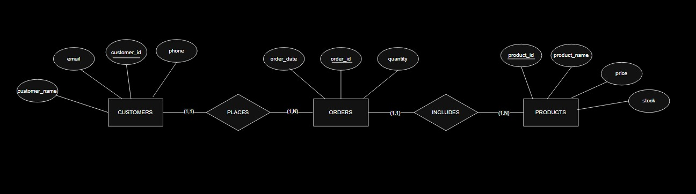
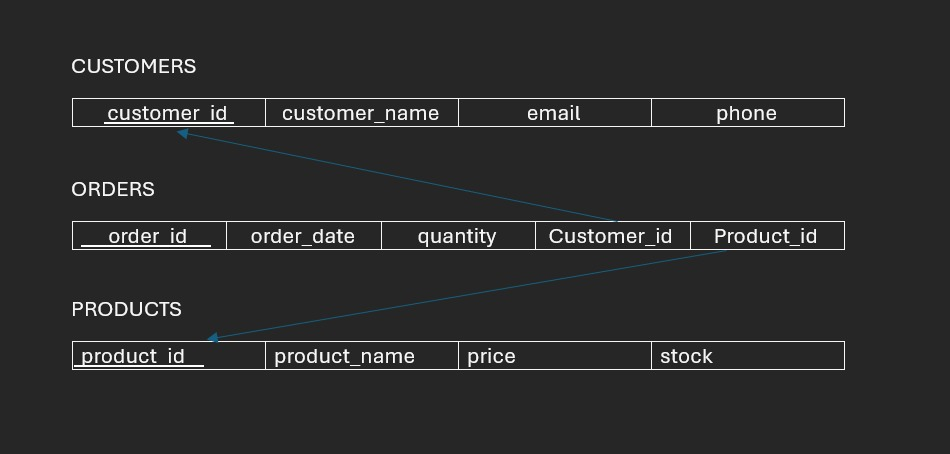

# 🛒 Online Store Database (MySQL)

A relational database for a small online store, designed from scratch: ER model, relational schema, constraints, sample data, and analytical SQL queries.


## 🎯 Project Goal

Model the core of an e-commerce system (customers, products, orders) and answer basic business questions using SQL: what sells, who buys, and how much.

## 🗂️ Database Design

### ER Diagram


### Relational Schema


| Table | Primary Key | Notes |
|---|---|---|
| `Customers` | `customer_id` | `email` is `UNIQUE` |
| `Products` | `product_id` | `CHECK (price > 0)`, `CHECK (stock >= 0)` |
| `Orders` | `order_id` | FKs to `Customers` and `Products`, `CHECK (quantity > 0)` |

**Relationships:** one customer places many orders (1:N), and one product can appear in many orders (1:N).

## 🔍 SQL Concepts Covered

- DDL: `CREATE`, constraints (`PRIMARY KEY`, `FOREIGN KEY`, `UNIQUE`, `CHECK`, `NOT NULL`), `ON DELETE CASCADE`
- DML: `INSERT`
- Filtering: `WHERE`
- Aggregation: `COUNT`, `SUM`, `GROUP BY`
- `JOIN` across tables
- Subqueries (`IN`)
- Views (`Order_Summary_Report`)

## 📁 Repository Structure

```
online-store-db/
├── sql/
│   ├── 01_schema.sql       # database + tables + constraints
│   ├── 02_seed_data.sql    # sample data
│   └── 03_queries.sql      # analysis queries + view
├── docs/
│   ├── er-diagram.jpeg
│   └── relational-schema.jpeg
└── README.md
```

## ▶️ How to Run

Requires MySQL 8.0.16+ (needed for `CHECK` constraints to be enforced).

```bash
mysql -u root -p < sql/01_schema.sql
mysql -u root -p < sql/02_seed_data.sql
mysql -u root -p < sql/03_queries.sql
```

> ⚠️ `01_schema.sql` drops `OnlineStoreDB` if it already exists.

## 📊 Example Queries

```sql
-- Total quantity ordered per product
SELECT product_id, SUM(quantity) AS total_quantity_ordered
FROM Orders
GROUP BY product_id;
```

```sql
-- Readable order report using a view
SELECT * FROM Order_Summary_Report;
```

## 🚀 Future Improvements

- Add an `Order_Items` table so one order can contain multiple products (the current design links each order to a single product).
- Add `unit_price` to the order line to preserve the price at purchase time.
- Add a trigger or transaction to reduce `Products.stock` when an order is placed.
- Add revenue analysis (`quantity * price`), top customers, and monthly sales queries.
- Connect the database to Power BI for a sales dashboard.

## 👤 Author

**Rayan Almihmadi**, Computer Science student at Umm Al-Qura University.
[GitHub](https://github.com/Rayan-Almihmadi)
